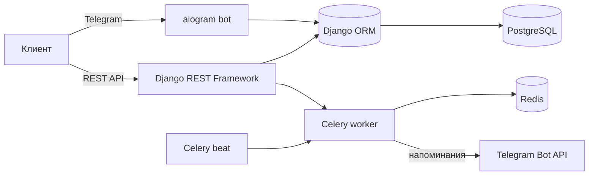
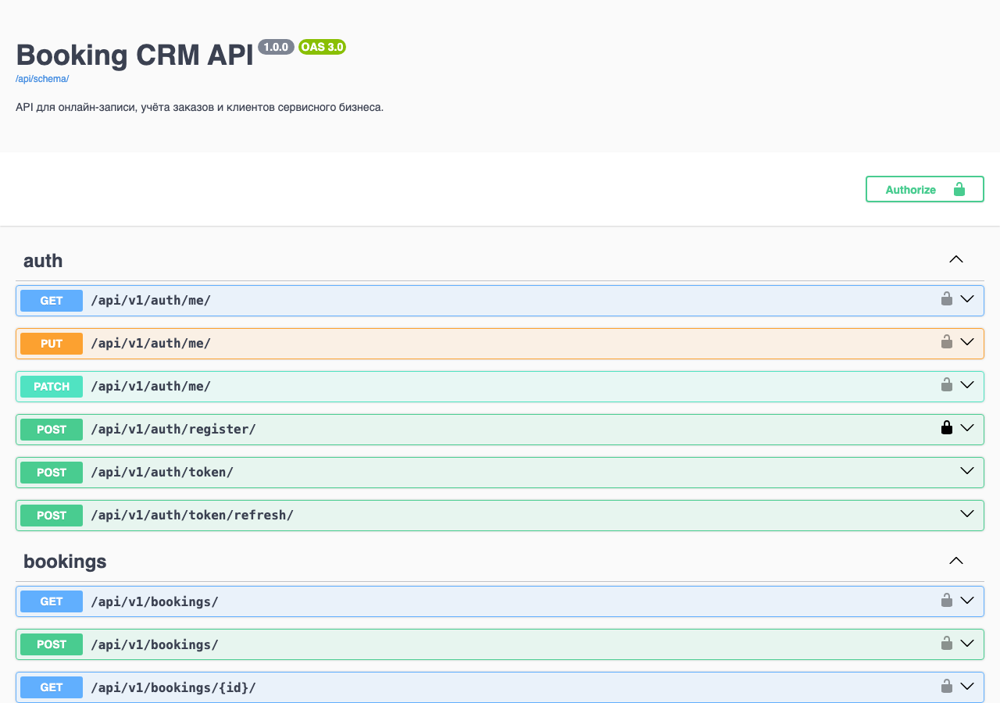

# Booking CRM

[](https://github.com/churilina-polina/booking-crm/actions/workflows/ci.yml)


Backend-система онлайн-записи и учёта заказов для сервисного бизнеса (салон, мастерская,
консультации и т.п.): клиенты записываются на услуги через REST API или Telegram-бота,
администратор ведёт расписание сотрудников и оплаты.

Разработано по заказу ИП как коммерческий проект.

> **In short (EN):** backend for an appointment-booking CRM for service businesses.
> REST API (Django REST Framework, JWT, role-based access), conflict-free slot booking,
> Telegram bot (aiogram), Celery/Redis reminders, reports with CSV export, Swagger docs,
> Docker, GitHub Actions CI, 26 automated tests.

## Как вёлся проект

Работа была разбита на 4 этапа, на каждом — проверяемый результат:

1. **Основа:** модели данных, авторизация (JWT), базовый CRUD API.
2. **Бизнес-логика:** проверка занятости слотов, статусы записей, права по ролям, тесты.
3. **Каналы и автоматизация:** Telegram-бот для записи и фоновые напоминания (Celery + Redis).
4. **Выпуск:** Docker, CI, Swagger-документация, отчёты и CSV-экспорт, инструкция по деплою.

Что выяснилось при проверке перед сдачей и было исправлено: отчёты считали «сегодня» по
времени сервера, а не бизнеса; анонимный запрос к списку записей давал 500 вместо 401;
контейнер не мог записать статику из-за прав пользователя. Часть случаев закрыта
автотестами, а работоспособность контейнеров проверена полным запуском docker-compose.

## Стек

- **Python 3.12, Django 5.1, Django REST Framework** — backend и REST API
- **PostgreSQL** — основное хранилище
- **JWT (SimpleJWT)** — аутентификация, ролевая модель (админ / сотрудник / клиент)
- **Celery + Redis + django-celery-beat** — фоновая отправка напоминаний о записи
- **aiogram 3** — Telegram-бот для клиентской записи
- **drf-spectacular** — автогенерация OpenAPI-схемы и Swagger UI
- **pytest + pytest-django + factory_boy** — тесты моделей и API
- **Docker / docker-compose** — контейнеризация всех сервисов
- **GitHub Actions** — CI (lint, форматирование, тесты на каждый push/PR)
- **black + isort + flake8** — единый стиль кода, проверяется в CI
- Троттлинг запросов (DRF throttling), `/health/` для проверки готовности сервиса

## Архитектура

```
config/          — настройки Django, Celery, urls
apps/users/      — кастомная модель пользователя, роли, JWT-эндпоинты
apps/services/   — услуги, сотрудники, расписание работы
apps/bookings/   — записи и оплаты, проверка занятости слотов
apps/notifications/ — лог уведомлений, Celery-задача напоминаний
bot/             — Telegram-бот (aiogram), работает поверх Django ORM
tests/           — фабрики данных и тесты (модели + API)
```

Ключевое бизнес-правило — недопущение пересечения записей одного сотрудника —
реализовано на уровне модели (`Booking.clean`) и покрыто тестами, поэтому конфликт
слотов невозможен независимо от того, откуда пришёл запрос: из REST API или из бота.
Расчёт свободных слотов вынесен в `apps/bookings/availability.py` и переиспользуется
и REST-эндпоинтом, и ботом — без дублирования логики.



## Роли

| Роль    | Доступ                                                             |
|---------|---------------------------------------------------------------------|
| client  | создаёт свои записи, видит и отменяет только их                    |
| staff   | видит все записи, подтверждает/завершает их, управляет услугами    |
| admin   | полный доступ, управление пользователями через админку             |

## Быстрый старт (Docker)

```bash
cp .env.example .env        # заполнить POSTGRES_*, TELEGRAM_BOT_TOKEN
docker compose up --build
docker compose exec web python manage.py seed_demo_data
```

- API: http://localhost:8000/api/v1/
- Swagger: http://localhost:8000/api/docs/
- Админка: http://localhost:8000/admin/ (admin / admin12345 после seed)



## Локальный запуск без Docker

```bash
python3 -m venv venv && source venv/bin/activate
pip install -r requirements-dev.txt   # requirements.txt — только рантайм-зависимости
cp .env.example .env   # для локальных тестов можно поставить USE_SQLITE=True
python manage.py migrate
python manage.py seed_demo_data
python manage.py runserver
```

Бот отдельным процессом: `python -m bot.main` (требуется `TELEGRAM_BOT_TOKEN` в `.env`).

## Тесты и качество кода

```bash
make check   # lint + format-check + tests, то же самое, что гоняет CI
make format  # автоформатирование black + isort
make test    # только тесты с покрытием
```

26 тестов покрывают бизнес-логику (конфликт слотов), права доступа по ролям, аутентификацию,
отчёты, экспорт и фоновую задачу напоминаний.

## Основные эндпоинты

- `POST /api/v1/auth/register/`, `POST /api/v1/auth/token/` — регистрация и JWT
- `GET/POST /api/v1/services/`, `/api/v1/employees/` — каталог услуг и сотрудников
- `GET /api/v1/employees/{id}/available_slots/?service=&date=` — свободные слоты
- `GET/POST /api/v1/bookings/`, `POST /api/v1/bookings/{id}/confirm|cancel|complete/`
- `GET/POST /api/v1/payments/`, `POST /api/v1/payments/{id}/mark_paid/`
- `GET /api/v1/reports/revenue/`, `GET /api/v1/reports/employee-load/` — аналитика для admin/staff
- `GET /api/v1/reports/bookings/export/` — выгрузка записей в CSV
- `GET /health/` — health-check (используется в Docker/деплое)

Полная интерактивная документация — в Swagger UI (`/api/docs/`).

## Демо-деплой на Render (бесплатно)

В репозитории есть `render.yaml`: Render собирает Docker-образ, использует SQLite и при каждом
старте применяет миграции и наполняет базу демо-данными (`seed_demo_data`). Бесплатный сервис
засыпает через 15 минут без запросов и просыпается примерно за минуту, а данные после перезапуска
создаются заново: этого достаточно для демонстрации.

1. На render.com выберите New → Blueprint и подключите этот репозиторий.
2. Дождитесь деплоя и откройте `<адрес сервиса>/api/docs/`.
3. Демо-логины: `admin` / `admin12345` и `master_anna` / `staff12345` (только демо-данные).

## Деплой

См. [DEPLOY.md](DEPLOY.md) — инструкция для Render.com и обычного VPS.
